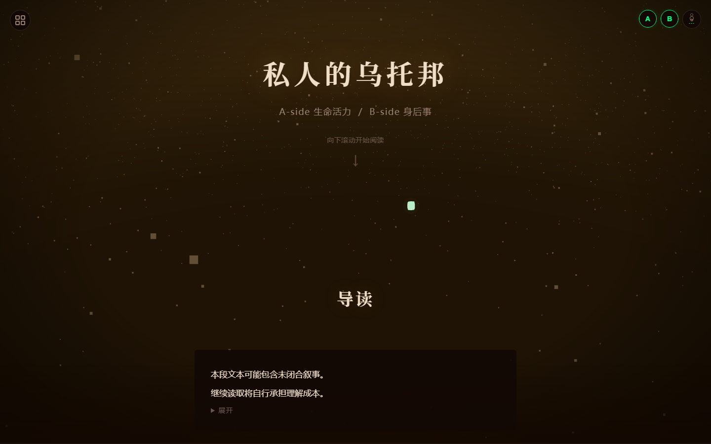

# 私人的乌托邦

> 交互式火星主题日记体小说 — Vue 3 + Vite 重构版（v2.0.0）

一部以火星为舞台、用日记体与诗体交替叙述的交互式小说。页面是一条单页滚动叙事线：随滚动向下，Three.js 实时渲染的火星地表、尘埃、绿色立方体与镜头同步推进；读者可以切换 A/B 两面、调整大气浓度、通过章节目录跳转。

- **A-side 生命活力**：诗体（pt.1 ~ pt.5）
- **B-side 身后事**：记录体（序 零之下，一 前兆 ~ 五 乌托邦，末 索拉里斯——亿万万）
- **在线阅读**：<https://timacton514.github.io/personal-utopia/>（部署后地址）



旧版纯静态实现（HTML + CSS + 原生 JS）已由本次 Vue 重构取代；原 README 中的小说 Markdown 原文已完整移入 [`docs/原文/`](docs/原文/)。

## 技术栈

| 类别 | 选型 |
| --- | --- |
| 框架 | [Vue 3](https://cn.vuejs.org/)（全部组件使用 `<script setup>` 组合式 API） |
| 构建 | [Vite](https://cn.vitejs.dev/)（`vite.config.js`；生产 base 为 `/personal-utopia/`） |
| 3D | [Three.js](https://threejs.org/) `0.163.0`（npm 依赖，非本地文件引用） |
| 状态 | 无 Pinia/Vuex；`src/composables/useStoryState.js` 的 reactive 单例 |
| 路由 | 无；单页滚动 + `#段落id` 锚点 |
| Node | `^20.19.0 || >=22.12.0`（见 `package.json` 的 `engines`） |

## 目录结构

```
PersonalUtopia/
├─ .github/
│  └─ workflows/
│     └─ deploy.yml               GitHub Pages 自动构建部署工作流
├─ docs/
│  ├─ ARCHITECTURE.md             架构说明（组件树、状态流、3D、扩展指南）
│  ├─ CONTENT_GUIDE.md            内容编辑指南（字段表、样式取值、新增章节）
│  ├─ preview.png                 页面预览截图
│  └─ 原文/
│     ├─ 私人的乌托邦.md           原 README 中的小说 Markdown 原文
│     └─ 私人的乌托邦合订.md       小说合订本（归档）
├─ public/                        静态资源目录（favicon.svg）
├─ src/
│  ├─ main.js                     应用入口：createApp(App).mount('#app')
│  ├─ App.vue                     页面骨架：加载遮罩、3D 画布、氛围层、文本层、全局控件
│  ├─ assets/
│  │  └─ styles/
│  │     ├─ index.css             样式入口（按顺序 @import 下列文件）
│  │     ├─ base.css              主题变量、字体、reset、body 背景
│  │     ├─ layout.css            画布 / 暗角 / 雾气 / 文本层 / 封面
│  │     ├─ segments.css          段落面板、meta 行、各种行样式、折叠
│  │     ├─ navigation.css        章节目录
│  │     ├─ controls.css          A/B/大气按钮
│  │     ├─ story-end.css         结尾面板与握手按钮
│  │     ├─ loading.css           加载遮罩
│  │     ├─ animations.css        keyframes
│  │     └─ responsive.css        响应式断点
│  ├─ components/
│  │  ├─ MarsCanvas.vue           <canvas id="mars-scene">
│  │  ├─ LoadingScreen.vue        加载遮罩（1.4s 后卸载）
│  │  ├─ TitleScreen.vue          封面
│  │  ├─ StoryFeed.vue            按顺序渲染全部段落 + IntersectionObserver
│  │  ├─ ChapterNav.vue           章节目录
│  │  ├─ ControlBar.vue           A/B 面与大气浓度按钮
│  │  ├─ ProgressBar.vue          底部阅读进度条
│  │  └─ segments/
│  │     ├─ StorySegment.vue      段落分发器（type → 组件）
│  │     ├─ ChapterHeaderSegment.vue
│  │     ├─ EntrySegment.vue      记录体（元数据、折叠、删除）
│  │     ├─ PoemSegment.vue
│  │     ├─ PaperSegment.vue
│  │     ├─ SystemSegment.vue
│  │     ├─ SearchSegment.vue
│  │     ├─ DividerSegment.vue
│  │     ├─ EndingSegment.vue
│  │     ├─ DefaultSegment.vue    未知 type 的回退
│  │     ├─ MetaHeader.vue        元数据行
│  │     ├─ RichText.vue          解析 ~~删除线~~
│  │     └─ StoryLine.vue         单行正文
│  ├─ composables/
│  │  ├─ useStoryState.js         全局状态与 action（单例）
│  │  ├─ useMarsScene.js          Three.js 场景的 Vue 生命周期封装
│  │  └─ useChapterNavigation.js  章节目录数据、高亮、上一章/下一章
│  ├─ data/
│  │  └─ novel-data.js            小说数据：68 个 segment
│  ├─ scene/
│  │  └─ MarsScene.js             火星 3D 场景类（Three.js）
│  └─ utils/
│     └─ scroll.js                平滑滚动到指定段落
├─ index.html                      Vite 入口 HTML（仅 #app 挂载点）
├─ package.json
├─ package-lock.json
├─ vite.config.js
└─ README.md
```

> 旧版静态实现（旧 `index.html` + `css/` + `js/` + `lib/`）已从工作区移除，其源码归档在 git tag `v1-static`，可用 `git show v1-static:js/ui.js` 等方式查看；旧版时期的临时文件（`1`、`2`、`dev`、`冲突解决`、`启动方式.txt`）也已清理。

## 本地运行

要求：Node.js `20.19+` 或 `22.12+`（推荐 22 LTS），npm。

```bash
npm install      # 安装依赖
npm run dev      # 开发服务器 → http://localhost:5173/
```

开发服务器开启了 `host: true`，同一局域网内的其它设备也可通过本机 IP 访问。

其它命令：

```bash
npm run build    # 生产构建，输出到 dist/
npm run preview  # 预览构建产物 → http://localhost:4173/personal-utopia/
```

> **注意预览地址带仓库名前缀**：生产构建的 base 是 `/personal-utopia/`（见 `vite.config.js` 的 `PRODUCTION_BASE`），所以 `npm run preview` 的完整地址是 `http://localhost:4173/personal-utopia/`，直接访问 `http://localhost:4173/` 会 404。开发服务器（`npm run dev`）不受影响，仍是根路径。

## 阅读与交互

| 操作 | 效果 |
| --- | --- |
| 滚动 / 触控滑动 | 推进剧情；3D 镜头、尘埃浓度、绿色立方体状态、藤蔓长度随之变化 |
| 左上角目录按钮 | 打开章节目录；点击章节跳转；点击面板外或按 `Esc` 收起 |
| 右上角 `A` / `B` 按钮 | 显示/隐藏 A 面（诗）/ B 面（记录） |
| 右上角大气按钮 | 大气浓度 1 → 5 循环，影响暗角、底部雾气与 3D 曝光 |
| `[` / `]` | 上一章 / 下一章 |
| `a` / `b` | 切换 A 面 / B 面 |
| 点击被消抹的删除线文字 | 临时「恢复」为正常文本 |
| 点击纸页样式段落 | 切换 `paper-expanded` 类（保留旧版点击交互；当前无对应样式规则，视觉不变） |
| 结尾握手符号 | 回到 B 面开头（序 零之下） |
| 带 `#段落id` 的链接 | 打开后自动滚动到对应段落 |

## 修改指南

| 想改什么 | 去哪里 |
| --- | --- |
| 小说正文、章节、段落字段、折叠/删除线 | `src/data/novel-data.js`，详见 [内容编辑指南](docs/CONTENT_GUIDE.md) |
| 配色、字体、间距等全局视觉 | `src/assets/styles/base.css` 的 `:root` 变量；具体样式在 `segments.css` 等文件 |
| 页面布局（画布、暗角、雾气、文本层） | `src/assets/styles/layout.css`、`src/App.vue` |
| 响应式（窄屏控件位置等） | `src/assets/styles/responsive.css` |
| 3D 火星场景与镜头运动 | `src/scene/MarsScene.js`；Vue 生命周期封装在 `src/composables/useMarsScene.js` |
| 滚动进度、大气浓度、A/B 可见性等交互状态 | `src/composables/useStoryState.js` |
| 章节目录与高亮逻辑 | `src/composables/useChapterNavigation.js`、`src/components/ChapterNav.vue` |
| 部署路径（仓库名/自定义域名） | `vite.config.js` 的 `PRODUCTION_BASE` |

样式入口是 `src/assets/styles/index.css`，其中 `@import` 的顺序就是层叠顺序，新增样式文件时注意放到合适位置。更完整的组件树、状态流与 3D 结构见 [架构说明](docs/ARCHITECTURE.md)。

## 部署到 GitHub Pages

项目使用 GitHub 官方 Pages Actions 自动部署，工作流文件为 [`.github/workflows/deploy.yml`](.github/workflows/deploy.yml)。

### 一次性配置

1. 把仓库推送到 GitHub；
2. 打开仓库 **Settings → Pages → Build and deployment**；
3. 把 **Source** 选为 **GitHub Actions**（不要选 “Deploy from a branch”）。

> **顺序很重要**：如果线上站点目前是用 “Deploy from a branch”（例如从 `master` 根目录）发布的，请先完成第 3 步、把 Source 改成 **GitHub Actions**，再推送本次重构提交。否则旧版 Pages 会直接把仓库根目录当作静态站点发布，而新的 `index.html` 需要 Vite 构建才能运行，线上会变成空白页。切换后旧版静态发布即失效，但旧代码仍在 tag `v1-static` 中可随时找回。

之后无需再手动配置。工作流会：

- 在推送到 **`master`** 分支时自动触发；
- 也可以在仓库 **Actions → Deploy to GitHub Pages → Run workflow** 手动触发（`workflow_dispatch`）；
- 执行 `npm ci` → `npm run build`，把 `dist/` 作为 Pages 产物上传并发布；
- 同一时刻只允许一个 Pages 部署，新的推送会取消排队中的旧部署。

部署成功后地址为：<https://timacton514.github.io/personal-utopia/>（仓库首页 Deployments / Actions 中也会显示 `page_url`）。

### 注意

- 生产构建的 base 固定为 `/personal-utopia/`，与仓库名一致；如果仓库改名或改用自定义域名，请同步修改 `vite.config.js` 中的 `PRODUCTION_BASE`。
- CI 使用 Node 22，与 `package.json` 的 `engines`（`^20.19.0 || >=22.12.0`）一致；依赖锁定在 `package-lock.json`，`npm ci` 可复现安装。
- `dist/` 已在 `.gitignore` 中忽略，构建产物由 Actions 上传，不需要提交到仓库。
- 如果 Pages 页面能打开但 JS/CSS 404，通常是 base 与仓库名不一致，检查 `PRODUCTION_BASE` 即可。

## 版本与归档

- 当前版本：Vue 3 + Vite 重构版（`package.json` 中 `version: 2.0.0`）。
- **旧版静态实现**（根目录旧 `index.html` + `css/styles.css` + `js/app.js`/`ui.js`/`scene.js`/`novel-data.js` + `lib/three.module.min.js`）已归档到 git tag **`v1-static`**（指向重构前的静态版提交）。需要回顾旧实现时执行 `git show v1-static:js/ui.js` 或 `git checkout v1-static` 查看；推送仓库时记得同时推送标签：`git push origin master --tags`。
- **原 README 的小说 Markdown 原文**已完整保存为 [`docs/原文/私人的乌托邦.md`](docs/原文/私人的乌托邦.md)（UTF-8 无 BOM，与原文件字节一致）；小说合订本归档为 [`docs/原文/私人的乌托邦合订.md`](docs/原文/私人的乌托邦合订.md)。

## 文档索引

- [架构说明](docs/ARCHITECTURE.md)：组件树、状态与数据流、3D 场景、扩展指南、旧版 → 新版对应关系
- [内容编辑指南](docs/CONTENT_GUIDE.md)：segment 字段表、`line.style` 取值、折叠与删除线、新增一章的步骤
- [小说原文](docs/原文/私人的乌托邦.md)、[小说合订本](docs/原文/私人的乌托邦合订.md)
